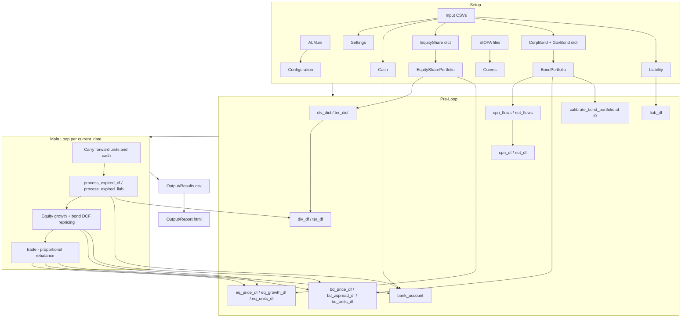

# OSEM Agent Instructions

Instructions for AI coding agents working on the **Open-Source Economic Model (OSEM)** — an asset-liability management (ALM) proof-of-concept for life insurers and pension funds.

## Project purpose

OSEM simulates, on an annual discrete timeline:

1. Evolution and performance of investments (equities, corporate and government bonds, cash)
2. Liability cash outflows
3. Proportional rebalancing to absorb liquidity surpluses and deficits

The entry point is `src/osem/main.py`. Configuration comes from `ALM.ini` and CSV files under `Input/`. Results are written to `Output/Results.csv`, and summarised for readers in `Output/Report.html`.

## Architecture

### Project layout

All production code is an installable package under `src/osem/` (`import osem`, `pyproject.toml` uses a `src`-layout with `[tool.setuptools.packages.find] where = ["src"]`). `unit_tests/`, `notebooks/`, `Documentation/`, `Input/`, `Output/`, `Intermediate/`, `Logs/`, and `ALM.ini` stay at the repository root — only the `.py` modules moved.

- **Elsewhere in this file**, a bare filename like `MainLoop.py` or `CurvesClass.py` means `src/osem/MainLoop.py` / `src/osem/CurvesClass.py` unless stated otherwise.
- **Setup:** `pip install -e .` (registers the `osem` package in editable mode; also installs `numpy`/`pandas`/`python-dateutil`).
- **Run:** `python -m osem.main`, or the `osem` console-script installed by the editable install, from the repository root (so `ALM.ini`/`Input/`/`Output/` resolve via `os.getcwd()` as before — this did not change).
- **Import inside the package:** modules import siblings as `from osem.CurvesClass import Curves`, never flat (`from CurvesClass import Curves`). Production code never imports from `unit_tests`: the tests import `osem`, so this creates a circular import that stops the model from loading. Check for stray editor auto-imports.
- **Tests:** `unit_tests/*.py` import the same way (`from osem.CurvesClass import Curves`). `pyproject.toml` sets `pythonpath = ["src"]` under `[tool.pytest.ini_options]`, so `pytest` resolves `osem` without requiring the editable install.
- **Notebooks:** each notebook locates the repo root by walking up for `ALM.ini`, then does `sys.path.insert(0, str(base_folder / "src"))` before importing `osem.*` — keep this bootstrap cell first if you add a new notebook that imports production code. Notebooks never read the live `Input/` or `Output/` folders: they load `notebooks/data/notebooks.ini`, which has the keys of `ALM.ini` and names a small, fixed input set in `notebooks/data/Input`, and `summary_charts.ipynb` reads `notebooks/data/Output/Results.csv`, which `python notebooks/data/make_results.py` regenerates.

### Two-layer design

| Layer | Contents | Mutated during the main loop? |
|-------|----------|-------------------------------|
| Static dataclasses | `EquityShare`, `CorpBond`, `GovBond`, `Cash`, `Liability`, `UnitLinkedPolicy`, `UnitLinkedFund`, `Society` — loaded once from CSV | No |
| pandas DataFrames | Prices, units, spreads, bank account, company account, cash-flow matrices, UL policy state, summary | Yes |

Individual `EquityShare` / `CorpBond` / `GovBond` instances hold metadata and pricing logic. All simulation state evolves in DataFrames. Do not write back to dataclass instances after import.

Portfolio wrappers (`EquitySharePortfolio`, `BondPortfolio`) are also static after setup.

### Dataflow



### Key files

| File | Role |
|------|------|
| `src/osem/main.py` | Orchestration: setup, pre-loop, annual loop, output |
| `src/osem/MainLoop.py` | Cash-flow matrices, date schedules, expiry processing, portfolio valuation, trading |
| `src/osem/CurvesClass.py` | EIOPA Smith-Wilson term structure (calibration, projection, discounting) |
| `src/osem/EquityClasses.py` | Equity pricing, cash flows, portfolio wrapper |
| `src/osem/BondClasses.py` | `FixedCouponBond` (bond cash flows, pricing, z-spread calibration), `CorpBond`, `GovBond`, `bonds_by_asset_id` (keys bonds by id, rejecting repeats), `BondPortfolio` wrapper (`asset_ids_of` lists the ids of one bond type) |
| `src/osem/LiabilityClasses.py` | Aggregated liability cash-flow profile (`cashflow` mode) |
| `src/osem/UnitLinkedClasses.py` | Unit-linked policy/fund/portfolio classes (`unit_linked` mode) |
| `src/osem/ImportData.py` | Load `ALM.ini`, CSV inputs, EIOPA curve files |
| `src/osem/ConfigurationClass.py` / `src/osem/SettingsClasses.py` | Config and run parameters (`liability_mode`, `random_seed`) |
| `src/osem/CashClass.py` | Initial cash balance |
| `src/osem/SocietyClass.py` | Mortality tables for unit-linked decrements |
| `src/osem/TraceClass.py` | Optional call tracing (`tracer`); enabled via `ALM.ini` `[TRACE]` |
| `src/osem/logging_utils.py` | `get_file_logger` (per-module log file in the `Logs` folder) and `set_log_level` (one level for all of them, through the `osem` package logger) |
| `src/osem/FrequencyClass.py` | Dividend/coupon frequency enums used by equity and bond classes |
| `src/osem/ReportClass.py` | Builds and reconciles the run report from the saved csv files; no model logic |
| `src/osem/report_template.html` / `src/osem/chart.umd.js` | Report page and the Chart.js copy built into it (both are package data in `pyproject.toml`) |
| `pyproject.toml` | Package metadata, `src`-layout config, pytest `pythonpath` |
| `ALM.ini` | Paths, logging, trace flags, intermediate output, input file names |
| `Input/` | Portfolio CSVs, parameters, curves, liabilities, UL inputs |
| `unit_tests/` | pytest suite (imports `osem.*`) — update when changing public behaviour |
| `Documentation/Unit_Linked_Methodology.md` | Unit-linked methodology (MVP) |
| `Documentation/Unit_Linked_Methodology.html` | Visual UL methodology guide |

### `ALM.ini` sections

| Section | Maps to |
|---------|---------|
| `[TRACE]` | `Configuration.trace_enabled` → `tracer.enabled` in `main.py` |
| `[LOGGING]` | `logging_level`: the level of every log file in `Logs/` and of the console, applied by `main.py` with `set_log_level`. An older `ALM.ini` may still set `file_name`; it is ignored, as the log file names are set in code |
| `[INTERMEDIATE]` | Optional intermediate CSV output paths (`intermediate_enabled`, `intermediate_path`) |
| `[INPUT]` | Input/output folder paths and file names (`input_*`, `output_path`). `corporate_bonds` names the corporate bond file (`input_corporate_bond_portfolio`); an older `ALM.ini` that calls it `bonds` still loads. `government_bonds` is optional: without it `input_government_bond_portfolio` stays empty. There is no `curves` key: the curve file is named in `Parameters.csv`, and an older `ALM.ini` that still has one loads and ignores it |
| `[BASE]` (optional) | Override `base_folder`; defaults to current working directory |

Note: `Configuration` also stores paths for `input_param_no_VA` and `input_spread`, but the main run loads EIOPA files via paths in `Settings` (`Parameters.csv`), not those `Configuration` fields directly.

## Methodology principles

### Interest rates

- Risk-free curve loaded from EIOPA files via `import_SWEiopa` (paths from `Input/Parameters.csv`: `EIOPA_param_file`, `EIOPA_curves_file`)
- `Curves` calibrates Smith-Wilson (`set_observed_term_structure` → `calc_fwd_rates` → `project_forward_rate` → `calibrate_projected`)
- After setup, `curves` is read-only in the main loop; asset pricing calls `retrieve_rates(proj_period, maturities, "Discount", spread)`

### Assets

- **Equities:** deterministic growth each period using the fixed per-asset `eq_growth_df[modelling_date]` column; not re-priced via DCF in the loop. Growth is scaled by `time_frac = (current_date - previous_date).days / 365.25`
- **Bonds:** carry forward `bd_price_df[previous_date]` into the new column, then DCF repricing each period via `price_bond_portfolio` (remaining flows discounted to `current_date` on the year `proj_period + 1` curve); z-spread calibrated once at t0 via `calibrate_bond_portfolio` (stored in `bd_zspread_df`, not on the bond instances). Corporate and government bonds go through all of this together: `main.py` loads both files into one `BondPortfolio`, so they share `cpn_df`, `not_df` and the `bd_*` tables, and their asset ids must not overlap

### Liabilities

Selected by `Settings.liability_mode` from `Input/Parameters.csv` (default `cashflow`):

- **`cashflow`:** precomputed absolute cash flows from `Input/Liability_Cashflow.csv` (single aggregated row); expired via `process_expired_liab`
- **`unit_linked`:** policy-level simulation from `Input/Unit_Linked_Policies.csv`, `Input/Unit_Linked_Fund.csv`, and `Input/mortality.csv` via `Society`; state in `ul_mv_df` / `ul_gv_df` / `ul_premium_df` (there is no separate active-flag matrix — a policy that dies or lapses simply has its row dropped from all three, see `apply_mortality` / `apply_lapse` in `MainLoop.py`, so `main.py` records each policy's path with `record_policy_history` as it goes); `process_unit_linked_period` after growth and before `trade()`; insurer fees go to `company_account` (not traded). See `Documentation/Unit_Linked_Methodology.md`

### Trading

- `trade()` in `MainLoop.py` proportionally buys or sells equities and bonds to drive `bank_account` toward zero
- Use `portfolio_market_value()` for combined equity + bond market value at a date (used in `trade()` and `main.py`)

### Main loop helpers (`MainLoop.py`)

| Function | Role |
|----------|------|
| `create_cashflow_dataframe(cf_dict, unique_dates)` | Build per-asset cash-flow matrix (rows = asset_id, columns = dates) |
| `create_liabilities_df(liabilities)` | Build liability cash-flow DataFrame from `Liability`, adding up amounts on a repeated date |
| `set_dates_of_interest(modelling_date, end_date)` | Annual projection date schedule (anniversaries of the modelling date, last one = `end_date`) |
| `sum_series(values)` | Add up a Series in order, keeping NaN visible in the total (`Series.sum` would skip it) |
| `portfolio_market_value(eq_price, eq_units, bd_price, bd_units, as_of)` | Total invested assets MV at a date column |
| `holdings_market_value(price, units, as_of)` | MV of the holdings in the given price and units tables at a date column; pass one asset class's tables to get that class's MV |
| `remaining_liability_payments(cash_flows)` | Undiscounted total of liability flows not yet expired |
| `portfolio_total_return(start_market_value, end_market_value, asset_income)` | Period total return including asset cash flows received; feeds UL capitalisation. Raises `ValueError` if the start market value is not above 0 |
| `assets_exhausted(market_value, cash)` | True when trading sold every asset and the bank account is still overdrawn (beyond rounding noise); `main.py` then stops the run |
| `process_expired_cf` / `process_expired_liab` | Expire cash flows, return cash amount and shrunk DataFrames |
| `find_terminated_positions` / `liquidate_positions` | Identify equities whose terminal flow expired and bonds whose notional was repaid (call before `process_expired_cf`) and zero their units so the paid-out value is not also kept in MV |
| `calculate_expired_dates` | Internal helper: dates on or before the deadline |
| `trade` | Proportional buy/sell to balance `bank_account` toward zero |
| `process_unit_linked_period` / `capitalize_policies` / `apply_premiums` / `apply_admin_fees` / `apply_mortality` / `apply_lapse` | Unit-linked period mechanics |
| `find_policy_exits` / `record_policy_history` | Identify the policies a mortality or lapse step removed, and build the rows of `UL_Policy_History.csv` |

### Main loop steps (per `current_date`)

1. Carry forward `eq_units_df`, `bd_units_df`, `bank_account` (and `company_account` if UL) from `previous_date`; record start cash and start market value
2. Expire cash flows in sequence, crediting/debiting `bank_account` and logging each to `summary_df`:
   - Dividends (`div_df`), coupons (`cpn_df`), equity terminal (`ter_df`), bond notional (`not_df`) via `process_expired_cf`
   - Liabilities (`liab_df`) via `process_expired_liab` when `liability_mode=cashflow`
3. Mark-to-market: apply equity growth using `eq_growth_df[modelling_date]` and `time_frac`; carry bond prices forward then reprice via `price_bond_portfolio`; record after-growth MV and the period total return (`portfolio_total_return`, which adds back the dividends, coupons and bond notionals credited in step 2; equity terminal flows are excluded because those equities are still in MV until liquidated in step 5 — matured bonds reprice to zero, so a price-only return would book their redemption as a loss)
4. If `liability_mode=unit_linked`: `process_unit_linked_period` (capitalize, premiums, fees, mortality, lapse); update `bank_account` and `company_account`; record each policy's value and exit with `record_policy_history`
5. Liquidate equities whose terminal flow was paid and bonds that matured in step 2 (`liquidate_positions`), record `Cash before trade`, then proportional `trade()`
6. Log period-end cash, end market value, the equity and bond split, and the government and corporate bond market values (rows picked with `bd_ptf.asset_ids_of`) to `summary_df`; set `previous_date = current_date`. If `assets_exhausted`, save `Results.csv` up to this date and raise `RuntimeError`: the outflows exceeded the whole portfolio, usually because the assets at the modelling date are too small for the liabilities. Otherwise advance `proj_period`

After the loop, `main.py` saves `Results.csv` (and `UL_Policy_History.csv` in `unit_linked` mode), then calls `create_report`.

## Coding conventions

Follow these patterns when adding or changing code. Prefer the style in `MainLoop.py` and `SettingsClasses.py` over older modules (`CurvesClass`, `EquityClasses`) where they differ.

### Portfolio and asset structure

- Build portfolios as a `dict[str, Asset]` keyed by `asset_id`, then pass to a portfolio wrapper:

  ```python
  eq_input = {equity_share.asset_id: equity_share for equity_share in get_equity_share(filename)}
  eq_ptf = EquitySharePortfolio(eq_input)
  ```

  For bonds, build the dict with `bonds_by_asset_id(...)` instead of a comprehension. A comprehension keeps the last of two bonds with the same `asset_id` and drops the other without a warning; `bonds_by_asset_id` raises.

- Asset ids are strings for every asset type: `EquityShare`, `CorpBond`, `GovBond` and `Cash`, and so the index of every asset DataFrame. A bond's id, corporate or government, is its ISIN. The illustrative equities and cash have dummy ids in ISIN format: `XX` (a code no country holds, so no real security has it), an asset-class tag (`EQ`, `CA`), the old integer id padded to 7 digits, and the ISIN check digit, such as `XXEQ00011250`. `EquityShare.__post_init__` and `FixedCouponBond._validate_bond_terms` reject an empty or non-string id. Policy, fund and liability ids are not asset ids and stay `int`.

- Portfolio wrappers expose a consistent API:

  | Method | Purpose |
  |--------|---------|
  | `is_empty()` / `add()` | Portfolio management |
  | `create_*_flows()` | Per-asset cash-flow dicts |
  | `unique_dates_profile()` | Unique payment dates |
  | `init_*_portfolio_to_dataframe()` | Initial price / units / (growth or z-spread) matrices |

- `EquitySharePortfolio` and `BondPortfolio` always hold a dict: passing `None` or nothing gives an empty one. Do not add `None` checks on `equity_share` or `bonds`.

- Mirror this shape when adding a new asset class: dataclass for the instrument, portfolio wrapper for aggregation, `get_*` loader in `ImportData.py`.

### Cash-flow pipeline

Standard flow:

```
instrument.create_single_cash_flows()
  → portfolio.create_*_flows()     # Dict[str, Dict[date, float]]
  → create_cashflow_dataframe()    # rows = asset_id, columns = dates
  → process_expired_cf() in loop   # per-unit flows × units
```

- **Assets:** cash flows are **per unit**; expiry multiplies by `units[expiration_date]`.
- **Liabilities:** cash flows are **absolute amounts**; `process_expired_liab` sums columns directly (no units).

### DataFrame layout

| DataFrame | Index | Columns |
|-----------|-------|---------|
| `eq_price_df`, `eq_units_df`, `bd_price_df`, `bd_units_df`, `bd_zspread_df` | `asset_id` | modelling dates |
| `div_df`, `cpn_df`, `ter_df`, `not_df` | `asset_id` | cash-flow dates |
| `bank_account` / `company_account` | single row (`loc[0, date]`) | modelling dates |
| `liab_df` | `liability_id` | liability payment dates |
| `ul_mv_df`, `ul_gv_df`, `ul_premium_df` | `policy_id` | modelling dates |

When adding a new date column in the loop, carry forward from `previous_date`, then update in place for `current_date`.

### CSV import (`ImportData.py`)

- Single-object loaders: `get_configuration()`, `get_settings()`, `get_cash()`, `get_liability()`, `get_unit_linked_fund()`, `get_society()`.
- Row iterators: `get_equity_share()`, `get_corporate_bonds()`, `get_government_bonds()`, `get_unit_linked_policies()` → `Iterator` (one instance per CSV row).
- The bond loaders call `check_asset_type()` on every row and raise if its `Asset_Type` is not `Corporate_Bond` or `Government_Bond` respectively, so a row in the wrong file fails loudly.
- Every asset loader reads `Asset_ID` as text, stripped of spaces, never as `int`.
- Use `encoding="utf-8-sig"`, `csv.DictReader`, dates as `'%d/%m/%Y'`.
- CSV column names are `Pascal_Case` (`Asset_ID`, `Market_Price`, etc.).
- Do not read CSVs inline in `main.py` — add a `get_*` function in `ImportData.py`.

### Configuration split

| Source | Class | Contents |
|--------|-------|----------|
| `ALM.ini` | `Configuration` (plain class) | File paths, logging, trace, intermediate output |
| `Input/Parameters.csv` | `Settings` (`@dataclass`) | Run parameters; `end_date` computed in `__post_init__` |

### Dates and time

- Modelling timeline: `set_dates_of_interest()` returns annual anniversaries of the modelling date (`modelling_date + relativedelta(years=k)`), so projection date `k` lines up with the projected curve for year `k` and the last date equals `Settings.end_date` — exactly `n_proj_years` dates. `main.py` raises if there are more dates than projected curve years. Do not step with fixed day counts: 365-day steps drift a day every leap year and overshoot the horizon.
- Year fractions: use `days / 365.25` in the main loop and DCF discounting (some older equity helpers use `365.5` — prefer `365.25` for new code).
- Payment schedules: `relativedelta(months=(12 // frequency))` from `issue_date`, skipping dates before `modelling_date`.
- `Frequency` is an `IntEnum` (`MONTHLY=12`, `QUARTERLY=4`, etc.) stored as int in CSV.
- **Coupon rate is per payment, not annualised.** `coupon_rate` on `CorpBond` and `GovBond` (CSV `Coupon_Rate`) is the rate paid on each coupon date whatever the `Frequency`: `coupon_amount() = coupon_rate × notional`. A quarterly bond with `Coupon_Rate 0.02` pays 8% a year. For a bond quoted with annual coupon `c` paid `f` times a year, enter `c / f`. This is intended behaviour — do not divide by the frequency in the code.
- **Dividend yield is per payment too.** `EquityShare.dividend_yield` (CSV `Dividend_Yield`) is the yield paid on each dividend date: `dividend_amount(price) = price × dividend_yield`. A quarterly share with `Dividend_Yield 0.01` pays about 4% a year; for an annual yield `y` paid `f` times a year, enter `y / f`. Same rule: do not divide by the frequency in the code.

### Pricing and curves

- Curve setup once in `main.py`; `curves` is read-only in the loop.
- Pricing calls `retrieve_rates(proj_period, maturities_numpy, "Discount", spread)`. The projected curve for year `k` has maturities measured from projection year `k`, so the two must match: `maturities_numpy` are year fractions from the **valuation date**, and `proj_period` is that date's projection year. In the main loop `proj_period` counts completed periods, so repricing at `current_date` passes `proj_period + 1`; the t0 calibration uses `0` and the modelling date.
- **Equity spreads:** `spread_country + spread_sector + spread_stress`.
- **Bond spreads:** z-spread calibrated once at t0 via bisection into `bd_zspread_df`, then read from the DataFrame during repricing (not from the bond's `zspread` field in the loop). This is the only spread in bond pricing: the country, sector and stress spreads, recovery rate and default probability on `CorpBond` are loaded but not used yet.

### Main-loop orchestration

- `main.py` is procedural and logging-heavy: each major step gets a `logger.info(...)` call.
- Loop logic lives in `MainLoop.py` as **module-level functions** that return updated state — callers must **reassign**:

  ```python
  cash, div_df, unique_div_dates = process_expired_cf(...)
  ```

- Use `portfolio_market_value()` for combined MV; do not add new inline `sum(...)` in `main.py` or `trade()`. For other Series totals in `MainLoop.py`, use `sum_series()`.

### Class and file naming

| Pattern | Example |
|---------|---------|
| `*Class.py` files | `EquityClasses.py`, `BondClasses.py` |
| Asset dataclass | `EquityShare`, `CorpBond`, `GovBond` |
| Portfolio wrapper | `EquitySharePortfolio`, `BondPortfolio` |
| Loop / orchestration | `MainLoop.py`, `main.py` |
| Import loaders | `get_equity_share`, `import_SWEiopa` |

### Function and method naming

**All functions and methods are `snake_case`, no exceptions.** This includes free functions, module-level helpers, and every method on every class (`Curves`, `BondPortfolio`, `EquitySharePortfolio`, `UnitLinkedPortfolio`, etc.). Classes and dataclasses stay `PascalCase` — this rule governs callables only, not type names.

| Rule | Example |
|------|---------|
| Functions/methods: `snake_case` | `calc_fwd_rates`, `is_empty`, `price_bond_portfolio` |
| Classes/dataclasses: `PascalCase` | `Curves`, `BondPortfolio`, `EquityShare` |
| `ImportData.py` loaders: `get_<noun>()`, noun fully lowercase/underscored — never the returned class's own casing | `get_cash()` (returns `Cash`), `get_equity_share()` (returns `EquityShare`), `get_liability()` (returns `Liability`) |
| Private/internal helpers: leading underscore optional but casing rule still applies | `calculate_expired_dates` |
| Test functions: `test_<function_or_behaviour>`, mirroring the snake_case name of what they test | `test_calc_fwd_rates`, `test_is_empty` |

Do not introduce PascalCase or camelCase for a new function or method, even to visually match an embedded class name (e.g. do not write `get_CorpBond` because the class is `CorpBond` — it is `get_corporate_bonds`/`get_corp_bond`). This was previously inconsistent (`Curves` methods were PascalCase, `IsEmpty()` was PascalCase, and `get_Cash`/`get_EquityShare`/`get_Liability` embedded the class name) and has been normalized across the codebase, call sites, and tests — keep new code consistent with this rule rather than with any lingering PascalCase.

### Type hints and arrays

- Pass **NumPy arrays** to curve/term-structure APIs. Convert pandas at the call site:

  ```python
  curves.set_observed_term_structure(
      maturity_vec=np.asarray(curve_country.index, dtype=np.float64),
      yield_vec=np.asarray(curve_country, dtype=np.float64),
  )
  ```

- Do not pass a bare pandas `Index` or `Series` to `pd.DataFrame(data=...)` inside curve methods — pandas treats them as column labels, not row data.
- Annotate arrays with their element type, such as `npt.NDArray[np.float64]` (`import numpy.typing as npt`), not a bare `np.ndarray`.
- Give empty lists and dicts a type when you create them: `date_frac: List[float] = []`.
- A warning-free run under Pylance's `strict` mode is the target. Prefer these forms, because the bundled pandas stubs flag the alternatives:

  | Instead of | Use |
  |------------|-----|
  | `series.to_numpy()`, `series.values` | `np.asarray(series, dtype=np.float64)` |
  | `df.loc[row, date]` as a value to read | `df[date].loc[row]`, with `row` declared with the index's type before a loop over it (`row: str` for an asset table) |
  | `index=some_dict.keys()` in `pd.DataFrame(...)` | `index=list(some_dict.keys())` |

- Fixing a type warning must not change results. Do not swap `sum_series` for `Series.sum` or `np.sum`: the first skips NaN, and the second can change the last digits of a total. Compare `Output/Results.csv` in both liability modes after such a change.

### State mutation

- Update DataFrames in the loop; never mutate `EquityShare` / `CorpBond` / `GovBond` instances after CSV import.
- `process_expired_cf` / `process_expired_liab` return updated DataFrames and date lists — callers must reassign (`div_df`, `unique_div_dates`, etc.).
- Expired cash-flow columns must be dropped via assignment (`cash_flows = cash_flows.drop(...)`) to avoid double-counting.

### Docstrings and logging

- Every function: short description, then `Parameters` and `Returns` sections.
- Use the hybrid Sphinx style already in the codebase (`:type param: type` under `Parameters`).
- Many modules set up a module-level `logger` with `get_file_logger` (`logging_utils.py`), each with a dedicated log file (e.g. `EquityClasses.log`, `BondClass.log`, `ALM.log`). The files go in the `Logs` folder of the working directory, created if missing; pass only a file name, not a path. The logger name must be inside the `osem` package: `__name__` in a package module, and `"osem.main"` in `main.py`, whose `__name__` is `"__main__"` when run with `-m`. Do not give a module logger a level of its own: it takes the `[LOGGING]` level through the `osem` package logger.

### Validation and immutability

- `CorpBond` is `@dataclass(frozen=True)` with range checks in `__post_init__`.
- `EquityShare` is a mutable `@dataclass` with lighter validation (asset id and frequency only).
- New bond-like instruments should follow the stricter `CorpBond` pattern: a frozen dataclass that inherits from `FixedCouponBond`, declares the attributes listed on it as its own fields, and calls `self._validate_bond_terms()` at the start of `__post_init__`. `FixedCouponBond` holds the shared cash-flow, pricing and calibration methods. Keep it a plain class: as a dataclass it would put its fields first and change the positional field order of `CorpBond`, which the tests rely on. All bond instruments go into one `BondPortfolio`, keyed by `asset_id`. `GovBond` follows this pattern with the shared fields plus `issuer_country`, and no credit-risk fields: the sovereign's risk enters only through the calibrated z-spread.

### Testing

- **pytest** with `@pytest.fixture` for instruments, curves, portfolios.
- Tests named `test_<behaviour>`; fixtures build objects inline with realistic dates and `Frequency` enums.
- Update `unit_tests/` when changing public behaviour.
- GitHub Actions (`.github/workflows/tests.yml`) runs `pytest` from the repository root on every push to `main` and every pull request: on Ubuntu with Python 3.10 and 3.13, and on Windows with Python 3.13. Keep the code working at both ends of the Python and pandas ranges in `pyproject.toml`, and keep paths free of Windows-only separators and file-name case mismatches, which pass on Windows but fail on Linux.
- `pytest` does not run the notebooks. When changing what a public function returns, also search `notebooks/` for its callers.
- Tests read the small fixture in `unit_tests/fixed_settings` (its `ALM.ini` and `Input` folder), never the project's `Input/` folder, so they do not change when the live inputs are retuned. The end-to-end runs in `test_Report.py` copy it into a temporary folder and take a few seconds each. Its 5 policies hold 720,000 and its assets about 817,000, so a unit-linked run lasts the 10 test years; keep them in that balance when editing either.
- A change to the live `Input/` files does not reach the notebooks or the tests. A change to an input format, such as a new column, does: make it in `notebooks/data/Input` and `unit_tests/fixed_settings/Input` too, then rerun `make_results.py` and the notebooks.

### Run report

- `ReportClass.py` only reads `Results.csv` and `UL_Policy_History.csv`, so a report can be rebuilt without running the model. Do not add model logic to it, or pass it live DataFrames from the main loop.
- A value the report needs goes into `summary_df` first. Add new columns at the end, so existing columns keep their order.
- `reconcile_results` checks that the displayed numbers add up. A failure logs a warning and shows a banner in the report; it does not stop the run. Add a check when adding a new balance.
- The report shows bonds as corporate (`Corporate bond market value`) and government (`Government bond market value`), and checks that the two add up to `Bond market value`. A `Results.csv` saved before those columns existed is read as holding no government bonds, and as holding `Bond market value` less government bonds in corporate bonds. In the assets chart, government bonds sit at the bottom of the stack because their yellow is too close to the corporate orange to sit next to it (run the dataviz palette validator before reordering or recolouring the series).
- In `unit_linked` mode the report draws a lane for at most `POLICY_LANES` (50) policies, the largest at the modelling date, and says how many there are in all; only those policies' paths go into the page. The reconciliation still uses every policy, from `UL_Policy_History.csv`. The year slider redraws on every tick, so keep that work small: never spread a whole data array into one call such as `Math.max(...values)`, which also fails outright beyond about 125,000 values.
- The report must stay a single file that opens offline: no external scripts, stylesheets or fonts. To upgrade Chart.js, replace `src/osem/chart.umd.js` and keep its licence header.

### Checklist for new code

1. Dataclass + portfolio wrapper for a new asset type.
2. `get_*` loader in `ImportData.py`.
3. `Dict[str, Dict[date, float]]` cash flows → matrix via `create_cashflow_dataframe`.
4. Simulation state in DataFrames (rows = `asset_id`, columns = dates).
5. Loop steps as `MainLoop.py` functions returning updated tuples.
6. NumPy arrays into `Curves` APIs.
7. `logger.info(...)` for major steps in `main.py`.
8. pytest coverage for the new public API.
9. Prefer minimal, focused diffs; do not commit secrets or machine-specific paths.

## Inputs and outputs

| Item | Source |
|------|--------|
| Configuration | `ALM.ini` → `Configuration` |
| Run parameters | `Input/Parameters.csv` → `Settings` |
| Portfolios | `Input/Cash_Portfolio.csv`, `Input/Equity_Portfolio.csv` (illustrative positions with dummy asset ids `XXCA…` and `XXEQ…`) |
| Corporate bonds | `Input/Corporate_Bond_Portfolio.csv`: 201 real euro fixed-coupon bullet bonds from the iShares Core € Corp Bond UCITS ETF holdings of 30 Oct 2026. They were picked from the bonds already issued at the modelling date, keeping the fund's sector mix with at most two bonds per issuer. Market prices are set on the t0 curve, the EIOPA EUR curve of 30 Sep 2026 in `Curves_no_VA.csv`, at each bond's z-spread observed on 30 Oct 2026 against that curve, so the calibration recovers those spreads (−39 bp to +164 bp); the market value is 31,706,531. The prices belong to that curve: after replacing the curve file, reprice the bonds at their observed spreads, or the calibration returns different ones. `Z_Spread` holds the sector median as the starting value, `Default_Probability` is the risk-neutral rate z / (1 − `Recovery_Rate`), floored at 0 (it is 0 for the seven bonds with a negative spread), and `Issue_Date` is the start of the first coupon period. `Asset_ID` is the bond's ISIN. `Issuer` is for reference; the loader does not read it |
| Government bonds | `Input/Government_Bond_Portfolio.csv`: 376 real euro fixed-coupon bullet bonds of 17 euro-area governments, from the ECB list of eligible marketable assets of 3 Nov 2026. The file holds every nominal bond of those governments issued by the modelling date and still outstanding. OpenFIGI tickers were used to leave out strips, inflation-linked, retail and EMTN issues, Greek PSI bonds and Portuguese perpetuals, as well as Malta and the domestic Croatian, Bulgarian, Lithuanian and Latvian lines, whose coupon frequency those sources do not give. Italian BTPs pay twice a year, so their `Coupon_Rate` is half the annual coupon; the others pay once a year. `Issue_Date` is the last coupon date on or before the first issue, so the coupon schedule lands on the maturity date. `Z_Spread` is 0 and `Market_Price` is the price on the t0 curve at a zero z-spread, so the calibration recovers spreads of 0. Each bond has the same market value, 790,401 in total. `Asset_ID` is the bond's ISIN |
| EIOPA curves | `Input/Param_no_VA.csv`, `Input/Curves_no_VA.csv` (paths in `Settings`) |
| Sector spreads | `Input/Sector_Spread.csv` (configured in `ALM.ini`; not yet used in main loop) |
| Liabilities | `Input/Liability_Cashflow.csv` (`cashflow` mode) |
| Unit-linked policies / fund | `Input/Unit_Linked_Policies.csv`, `Input/Unit_Linked_Fund.csv` (`unit_linked` mode) |
| Mortality | `Input/mortality.csv` (used in `unit_linked` mode via `Society`) |
| Output | `Output/Results.csv` (`summary_df`) |
| Policy history | `Output/UL_Policy_History.csv` (`unit_linked` mode; one row per policy per date while in force, and one for its exit; not committed) |
| Run report | `Output/Report.html` (single offline page built from the two files above; not committed) |
| Notebook inputs | `notebooks/data/notebooks.ini`, `notebooks/data/Input/` (small, fixed input set the notebooks read instead of `Input/`) and `notebooks/data/Output/Results.csv` (a `cashflow` run on it); see `notebooks/README.md` |
| Logs | `Logs/ALM.log` (`main.py`, `ReportClass.py`), `Logs/EquityClasses.log`, `Logs/BondClass.log` (appended to on every run; only `Logs/.gitkeep` is committed) |

`summary_df` columns written per modelling date:

| Column | Meaning |
|--------|---------|
| `Start cash` / `End cash` | Bank account at period start/end |
| `Start market value` / `After growth market value` / `End market value` | Portfolio MV before flows, after growth, after trading |
| `Portfolio return` | Total return: (after-growth MV + dividends + coupons + bond notionals received in the period) / previous end MV − 1, via `portfolio_total_return` |
| `Dividend cash flow` / `Coupon cash flow` / `Terminal cash flow` / `Notional cash flow` | Expired asset cash flows credited to bank account; coupons and notionals include corporate and government bonds |
| `Liability cash flow` | Expired liability outflow (cashflow mode; stored as negative of cash debited) |
| `UL gross premium cash flow` / `UL entry fee cash flow` / `UL admin fee cash flow` | Unit-linked premium and fee flows (UL mode) |
| `UL mortality cash flow` / `UL lapse cash flow` | Liquidation outflows (negative; UL mode) |
| `UL reserve` / `Company account` | Active policy MV sum; insurer fee balance |
| `UL policies in force` / `UL deaths` / `UL lapses` | Policy counts (UL mode) |
| `Equity market value` / `Bond market value` | End-of-period MV by asset class; they add up to `End market value`. `Bond market value` covers corporate and government bonds together |
| `Cash before trade` | Bank account just before `trade()`; negative means assets are sold, positive means they are bought |
| `Remaining liability payments` | Undiscounted liability flows not yet expired (cashflow mode) |
| `UL return credited` | Portfolio return credited to policy accounts (UL mode) |
| `Government bond market value` | End-of-period MV of the government bonds, which is part of `Bond market value`; zero when `ALM.ini` names no government bond file |
| `Corporate bond market value` | End-of-period MV of the corporate bonds; with `Government bond market value` it adds up to `Bond market value` |

## Deeper documentation

Do not duplicate full methodology here. Refer to:

- `Documentation/Unit_Linked_Methodology.md` / `Documentation/Unit_Linked_Methodology.html` — unit-linked MVP
- `Documentation/OSEM_Documentation_draft.ipynb` — same content as notebook
- `notebooks/prototypes/` — maintained topic-specific deep dives and their rendered PDFs
- `notebooks/examples/` — maintained example-output notebooks and their rendered PDFs

## Maintenance

When architecture, conventions, or planned features change, update this file in the same PR as the code change.
